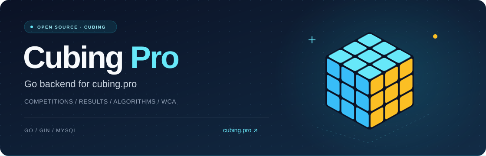
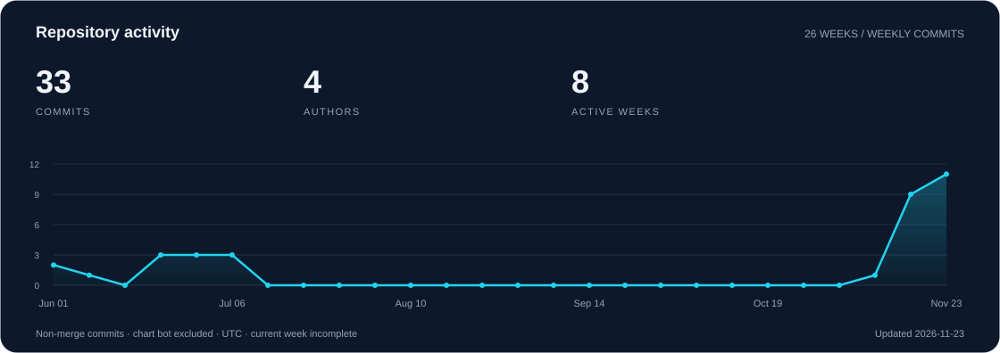

<p align="center">
  
</p>

<p align="center"><a href="README.md">中文</a> · <strong>English</strong></p>

<p align="center">
  <a href="https://github.com/guojia99/cubing-pro/stargazers"></a>
  <a href="https://github.com/guojia99/cubing-pro/network/members"></a>
  <a href="https://github.com/guojia99/cubing-pro/graphs/contributors"></a>
  <a href="https://github.com/guojia99/cubing-pro/commits"></a>
  <a href="go.mod"></a>
  <a href="LICENSE"></a>
</p>

<p align="center">
  <a href="https://cubing.pro"><strong>Visit website ↗</strong></a> ·
  <a href="#local-setup">Quick start</a> ·
  <a href="#developer-guide">Documentation</a> ·
  <a href="#contributors">Contributors</a> ·
  <a href="https://github.com/guojia99/cubing-pro/issues">Report an issue</a>
</p>

---

## Overview

**Cubing Pro** is the Go backend for [cubing.pro](https://cubing.pro), providing Gin HTTP APIs, a static-site and API gateway, and QQ / CQHTTP bots. The website frontend is maintained in the separate [cubing.pro repository](https://github.com/guojia99/cubing.pro).

| Capability | What it provides |
| --- | --- |
| 🏁 Competitions & results | Competitions, registration, result entry, group competitions, rankings, and records |
| 🧩 Algorithms & discussions | Algorithm catalogs, Trainer data, and algorithm discussion APIs |
| 🌍 WCA data | Competitor and result queries, statistics, data synchronization, and OAuth login |
| 🤖 Bots | Competition, result, and algorithm queries through QQ / CQHTTP |
| ⚡ APIs & gateway | A shared `/v3/cube-api` route prefix, static-site hosting, and an HTTP / TLS gateway |

**Stack**: Go · Gin · GORM · MySQL · Cobra. Frontend build artifacts, tNoodle, and other optional services must be prepared separately as needed.

## Requirements

- **Go 1.25.0+**, Git, and Make. See [go.mod](go.mod) for the Go requirement.
- **MySQL 8.0.16+**: the application database supports MySQL only. Offline WCA SQLite exports still require CGO and a C compiler.
- Non-macOS builds link `src/internel/scramble/librust_scramble.a`, which must match the target system and architecture, even when tNoodle is selected at runtime.
- On macOS, `rust_twisty` is a placeholder returning `[macOS-disabled]`. For real scrambles, configure an external tNoodle service supporting the `/frontend/...` interfaces used by the code. See [development](docs/development.md).

## Local setup

Run commands from the repository root after cloning:

```bash
git clone https://github.com/guojia99/cubing-pro.git
cd cubing-pro
go mod download
make init-config
```

By default, `make init-config` copies `etc/server.yaml` to `local/server_local_dev.yaml` without overwriting an existing file. Setting `CONFIG` changes the destination. The example uses local HTTP and MySQL with bots disabled. Before running, prepare a local database, replace the example DSN, and review paths and ports. Keep private settings in `local/`, which is ignored by Git.

```bash
make config-test
make api
```

The API listens on the configured `api.host` and `api.port`. Routes share the `/v3/cube-api` prefix, for example `GET /v3/cube-api/auth/code`. Startup connects to the application database and attempts AutoMigrate; it does not prepare complete business data or optional services. `config-test` tests only the configuration package, not application startup or external services.

Makefile commands default to `local/server_local_dev.yaml`. Override it explicitly when needed:

```bash
make api CONFIG=local/server_local_dev.yaml
# Optionally start the gateway in another terminal
make gateway CONFIG=local/server_local_dev.yaml
```

Use `make help` to list targets and `make build` (also available as `make build_root`) to compile the root entry point. Read the [development and verification boundaries](docs/development.md) before running or testing.

## Optional dependencies

<details>
<summary><strong>Expand for external services and data by feature</strong></summary>

| Feature | What to prepare |
| --- | --- |
| tNoodle scrambles | An external HTTP service; `global.scramble.endpoint` must match its interfaces. The Go API does not start this service |
| Scramble images | The current `2mf8` branch uses a hardcoded external service; `global.scramble.scramble` does not override its address |
| WCA queries & synchronization | Separate WCA MySQL data and the `global.wcaDB` path. Synchronization downloads, imports, and cleans up data; do not substitute the application database |
| WCA OAuth login | WCA application credentials, the correct callback URL, and allowed frontend redirects; see the [integration guide](docs/WCA_LOGIN_FRONTEND_GUIDE.md) |
| Email | Working SMTP settings in `global.emailConfig` |
| Algorithm catalog | With `global.algTrainersPath` configured, the API reads the adjacent `Algs/catalog.json` and Trainer data; see [script documentation](scripts/README.md) |
| Static-site gateway | Separately built frontend files; HTTPS requires a certificate and private key. See [deployment](docs/deployment.md) |
| QQ / CQHTTP bots | Accounts, credentials, or a CQHTTP service, with the relevant configuration explicitly enabled |

</details>

Disabling scheduled jobs and WCA synchronization does not guarantee offline operation: some imported packages may access the network and write caches in `init()`.

## Developer guide

The README is available in both languages. Linked technical guides are currently in Chinese.

| Path | Purpose |
| --- | --- |
| `main.go`, `cmd/` | Cobra entry point and subcommands |
| `src/api/`, `src/gateway/`, `src/robot/` | HTTP APIs, gateway, and bots |
| `src/configs/`, `src/internel/`, `src/wca/` | Configuration, business logic, and WCA data; `internel` is the historical spelling |
| `etc/`, `local/` | Public configuration/service examples and private local settings |
| `build/Algs/`, `build/Alg-Trainers/` | Algorithm and Trainer data, not Go binary output |
| `scripts/`, `docs/` | Data maintenance scripts and technical guides |

- [Development](docs/development.md): startup flow, build conditions, and choosing tests.
- [Configuration](docs/configuration.md): fields and local settings.
- [Deployment](docs/deployment.md): gateway, static assets, and services.
- [Production go-live](docs/production-go-live.md): required configuration, startup checks, and rollback.
- [Source map](src/SOURCE_STRUCTURE.md) and [contribution guide](CONTRIBUTING.md): modules, PR scope, third-party code, and verification.
- [Scripts](scripts/README.md), [developer tools](tools/README.md), and [maintenance](docs/maintenance.md): data operations, experiments, and outstanding maintenance work.
- [WCA login](docs/WCA_LOGIN_FRONTEND_GUIDE.md), [group competition API](docs/group-competition-api.md), and [algorithm discussions](docs/formula-forum.md).
- [Changelog](CHANGELOG.md) and [README widget maintenance](docs/readme-widgets.md).

## Contributors

Thank you to everyone improving Cubing Pro. Code, documentation, translations, bug reports, and feature ideas all help the community grow.

<p align="center">
  <a href="https://github.com/guojia99/cubing-pro/graphs/contributors">
    
  </a>
</p>

<p align="center">
  <a href="https://github.com/guojia99/cubing-pro/graphs/contributors">All contributors</a> ·
  <a href="CONTRIBUTING.md">Contribute</a> ·
  <a href="https://github.com/guojia99/cubing-pro/issues/new">Open an issue</a> ·
  <a href="https://github.com/guojia99/cubing-pro/pulls">Pull requests</a>
</p>

Read the [contribution guide](CONTRIBUTING.md), validate the affected scope, and report the checks you actually ran in your PR. For documentation changes, check links, commands, and `git diff --check`. See the [development guide](docs/development.md) for database requirements and external side effects in business tests.

## Development activity

<a href="https://github.com/guojia99/cubing-pro/graphs/commit-activity">
  
</a>

This chart uses **this repository's commits over the last 26 weeks**, grouped into UTC calendar weeks. Merge commits and commits by the README chart bot are excluded. Authors are counted by unique Git mailmap-normalized email addresses, which differs from GitHub's contributor count; the current week may be incomplete. GitHub Actions refreshes the chart weekly and supports manual runs. See [widget maintenance](docs/readme-widgets.md).

### Star History

<a href="https://www.star-history.com/#guojia99/cubing-pro&amp;Date">
  <picture>
    <source media="(prefers-color-scheme: dark)" srcset="https://api.star-history.com/svg?repos=guojia99/cubing-pro&amp;type=Date&amp;theme=dark" />
    <source media="(prefers-color-scheme: light)" srcset="https://api.star-history.com/svg?repos=guojia99/cubing-pro&amp;type=Date" />
    
  </picture>
</a>

The contributor wall, badges, and Star chart use third-party services. If they fail to load, view [GitHub contributors](https://github.com/guojia99/cubing-pro/graphs/contributors), [commit activity](https://github.com/guojia99/cubing-pro/graphs/commit-activity), and [Stars](https://github.com/guojia99/cubing-pro/stargazers) directly. The bundled activity chart displays independently.

## Acknowledgments

Thanks to these upstream projects. Third-party code, data, and assets remain subject to their respective licenses and attribution requirements.

- [wca-tnoodle](https://github.com/thewca/tnoodle): backend scramble and image integrations.
- [cstimer](https://github.com/cs0x7f/cstimer): frontend scramble image rendering.
- [blddb](https://github.com/nbwzx/blddb): some bot algorithm-query data.

## Contributing & license

Read [CONTRIBUTING.md](CONTRIBUTING.md) before submitting changes. This project is licensed under **GNU GPLv3**; see [LICENSE](LICENSE). Preserve the license notices for third-party subtrees and data.
