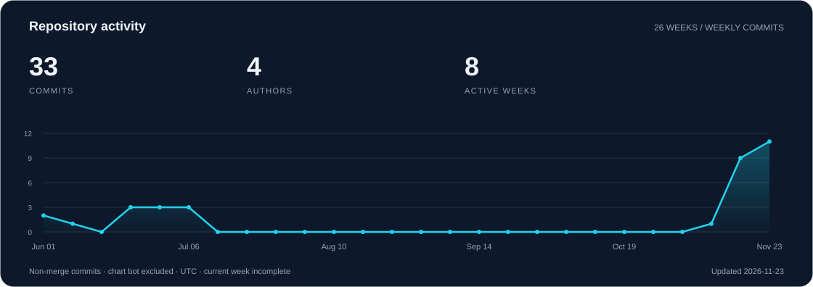

<p align="center">
  
</p>

<p align="center"><strong>中文</strong> · <a href="README.en.md">English</a></p>

<p align="center">
  <a href="https://github.com/guojia99/cubing-pro/stargazers"></a>
  <a href="https://github.com/guojia99/cubing-pro/network/members"></a>
  <a href="https://github.com/guojia99/cubing-pro/graphs/contributors"></a>
  <a href="https://github.com/guojia99/cubing-pro/commits"></a>
  <a href="go.mod"></a>
  <a href="LICENSE"></a>
</p>

<p align="center">
  <a href="https://cubing.pro"><strong>访问网站 ↗</strong></a> ·
  <a href="#本地开始">快速开始</a> ·
  <a href="#目录与文档">开发文档</a> ·
  <a href="#contributors">贡献者</a> ·
  <a href="https://github.com/guojia99/cubing-pro/issues">问题反馈</a>
</p>

---

## 项目介绍

**Cubing Pro** 是 [cubing.pro](https://cubing.pro) 的 Go 后端，包含 Gin HTTP API、静态站点与 API 网关、QQ / CQHTTP 机器人。网站前端在独立的 [cubing.pro 仓库](https://github.com/guojia99/cubing.pro)中维护。

| 能力 | 可以做什么 |
| --- | --- |
| 🏁 赛事与成绩 | 支持比赛、报名、成绩录入、群比赛、排名与纪录 |
| 🧩 公式与交流 | 提供公式目录、Trainer 数据与公式讨论接口 |
| 🌍 WCA 数据 | 接入选手与成绩查询、统计、数据同步及 OAuth 登录 |
| 🤖 机器人 | 将比赛、成绩、公式查询等能力接入 QQ / CQHTTP |
| ⚡ API 与网关 | 提供统一的 `/v3/cube-api` 路由、静态站点与 HTTP / TLS 网关 |

**技术栈**：Go · Gin · GORM · MySQL · Cobra。前端构建产物、tNoodle 和其他可选服务需按功能另行准备。

## 环境要求

- Go **1.25.0 起**，版本要求见 [go.mod](go.mod)；安装 Git 和 Make。
- 业务数据库仅支持 MySQL 8.0.16+。WCA 离线 SQLite 导出仍依赖 CGO / C 编译器。
- 非 macOS 构建会链接 `src/internel/scramble/librust_scramble.a`，需要与目标系统、架构兼容的原生库和链接环境；配置为 `tnoodle` 也不会移除这项编译依赖。
- macOS 的 `rust_twisty` 实现是占位实现，会返回 `[macOS-disabled]`，不能作为真实打乱。使用 `tnoodle` 时需单独运行提供代码所调用 `/frontend/...` 接口的外部服务，见[开发指南](docs/development.md)。

## 本地开始

以下命令在仓库根目录执行（克隆后的 `cd` 除外）：

```bash
git clone https://github.com/guojia99/cubing-pro.git
cd cubing-pro
go mod download
make init-config
```

`make init-config` 默认从 `etc/server.yaml` 创建 `local/server_local_dev.yaml`，已有文件不会覆盖；指定 `CONFIG` 时改用该目标路径。示例采用本地 HTTP、MySQL，并禁用机器人；首次运行前准备数据库并修改示例 DSN，检查路径和端口。`local/` 已被 Git 忽略，不要提交私人配置。

```bash
make config-test
make api
```

API 路由统一以 `/v3/cube-api` 为前缀，例如 `GET /v3/cube-api/auth/code`；监听地址以配置的 `api.host`、`api.port` 为准。启动会连接业务数据库并尝试 AutoMigrate，不会自动准备完整业务数据或所有可选服务。`config-test` 只覆盖配置包测试，不是应用启动检查。

Makefile 的 `CONFIG` 默认仍是 `local/server_local_dev.yaml`，可显式指定其他配置：

```bash
make api CONFIG=local/server_local_dev.yaml
# 另一个终端按需启动网关
make gateway CONFIG=local/server_local_dev.yaml
```

`make help` 查看目标；`make build`（兼容目标 `make build_root`）编译根入口。运行和测试前请先阅读[开发与验证边界](docs/development.md)。

## 按需准备的依赖

<details>
<summary><strong>展开查看各功能所需的外部服务与数据</strong></summary>

| 功能 | 需要准备 |
| --- | --- |
| tNoodle 打乱 | 外部 HTTP 服务；`global.scramble.endpoint` 应与其接口匹配，Go API 不负责启动该服务 |
| 打乱图片 | 当前 `2mf8` 绘图分支访问代码内固定的外部服务；`global.scramble.scramble` 不会覆盖该地址 |
| WCA 本地数据查询与同步 | 独立的 WCA MySQL 数据、`global.wcaDB` 路径；同步还涉及下载、导入和清理，不能用业务数据库替代独立 WCA 库 |
| WCA OAuth 登录 | WCA 应用凭据、准确的回调地址和前端跳转允许列表，见[前端对接手册](docs/WCA_LOGIN_FRONTEND_GUIDE.md) |
| 邮件 | `global.emailConfig` 中可用的 SMTP 配置 |
| 公式库 | 配置 `global.algTrainersPath` 时会读取相邻的 `Algs/catalog.json` 和 Trainer 数据；来源与导入条件见[脚本说明](scripts/README.md) |
| 网关静态站点 | 单独准备前端构建目录；HTTPS 需证书和私钥，见[部署指南](docs/deployment.md) |
| QQ / CQHTTP 机器人 | 对应账号、凭据或 CQHTTP 服务，并显式启用配置项 |

</details>

禁用定时任务与 WCA 同步不代表进程完全离线：部分导入包的 `init()` 仍可能联网并写入缓存。

## 目录与文档

| 路径 | 用途 |
| --- | --- |
| `main.go`、`cmd/` | Cobra 命令入口与子命令 |
| `src/api/`、`src/gateway/`、`src/robot/` | HTTP API、网关、机器人 |
| `src/configs/`、`src/internel/`、`src/wca/` | 配置、业务实现、WCA 数据层；`internel` 是历史目录拼写 |
| `etc/`、`local/` | 公开配置/服务示例、本地私人配置 |
| `build/Algs/`、`build/Alg-Trainers/` | 公式与 Trainer 数据，不是 Go 二进制输出目录 |
| `scripts/`、`docs/` | 数据维护脚本与专题文档 |

- [开发指南](docs/development.md)：启动链、构建条件和测试选择。
- [配置说明](docs/configuration.md)：配置字段与本地设置。
- [部署指南](docs/deployment.md)：网关、静态资源与服务部署。
- [后端上线须知与材料清单](docs/production-go-live.md)：上线配置核对、材料清单、启动验收与回滚。
- [源码导航](src/SOURCE_STRUCTURE.md)：模块职责和扩展位置。
- [贡献指南](CONTRIBUTING.md)：PR 范围、第三方代码与验证要求。
- [脚本说明](scripts/README.md)：条件迁移、数据导入与统计工具。
- [开发工具](tools/README.md)、[后续维护事项](docs/maintenance.md)：独立实验工具及尚需单独处理的初始化、凭据和资源问题。
- [WCA 登录前端对接](docs/WCA_LOGIN_FRONTEND_GUIDE.md)、[群比赛 API](docs/group-competition-api.md)。
- [公式论坛](docs/formula-forum.md)、[更新记录](CHANGELOG.md)、[README 图表维护](docs/readme-widgets.md)。

## Contributors

感谢每一位让 Cubing Pro 变得更好的开发者。代码、文档、翻译、问题反馈与功能建议，都是对社区的贡献。

<p align="center">
  <a href="https://github.com/guojia99/cubing-pro/graphs/contributors">
    
  </a>
</p>

<p align="center">
  <a href="https://github.com/guojia99/cubing-pro/graphs/contributors">全部贡献者</a> ·
  <a href="CONTRIBUTING.md">参与开发</a> ·
  <a href="https://github.com/guojia99/cubing-pro/issues/new">提交 Issue</a> ·
  <a href="https://github.com/guojia99/cubing-pro/pulls">查看 Pull Requests</a>
</p>

提交前请阅读[贡献指南](CONTRIBUTING.md)，按改动范围验证，并在 PR 中说明实际运行的检查。文档改动可核对链接、命令和 `git diff --check`；业务测试的数据库与外部副作用边界见[开发指南](docs/development.md)。

## 开发活跃度

<a href="https://github.com/guojia99/cubing-pro/graphs/commit-activity">
  
</a>

曲线来自**本仓库最近 26 周的提交记录**，按 UTC 自然周统计，排除合并提交和 README 图表机器人的提交。作者数按 Git mailmap 归一后的邮箱去重，与 GitHub 贡献者数量的统计口径不同；当前周可能尚未结束。图表由 GitHub Actions 每周更新，也可手动触发，见[图表维护说明](docs/readme-widgets.md)。

### Star History

<a href="https://www.star-history.com/#guojia99/cubing-pro&amp;Date">
  <picture>
    <source media="(prefers-color-scheme: dark)" srcset="https://api.star-history.com/svg?repos=guojia99/cubing-pro&amp;type=Date&amp;theme=dark" />
    <source media="(prefers-color-scheme: light)" srcset="https://api.star-history.com/svg?repos=guojia99/cubing-pro&amp;type=Date" />
    
  </picture>
</a>

头像墙、徽章与 Star 曲线由第三方服务提供；加载失败时，可直接查看 [GitHub 贡献者](https://github.com/guojia99/cubing-pro/graphs/contributors)、[提交活跃度](https://github.com/guojia99/cubing-pro/graphs/commit-activity)与 [Stars](https://github.com/guojia99/cubing-pro/stargazers)。仓库内置活跃图可独立显示。

## 第三方来源

保留项目已有的来源说明；具体代码、数据和资源还需遵守各自许可与署名要求。

- [wca-tnoodle](https://github.com/thewca/tnoodle)：用于后端打乱和打乱图片。
- [cstimer](https://github.com/cs0x7f/cstimer)：用于前端打乱图片渲染。
- [blddb](https://github.com/nbwzx/blddb)：部分数据用于机器人公式查询。

## 贡献与许可

提交改动前请阅读 [CONTRIBUTING.md](CONTRIBUTING.md)。项目使用 **GNU GPLv3**，全文见 [LICENSE](LICENSE)；第三方子树与数据的许可说明需一并保留。
